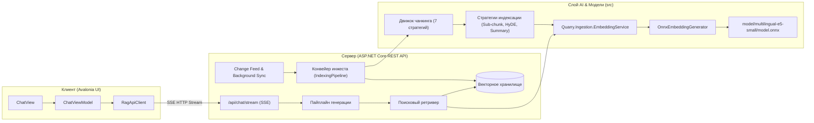
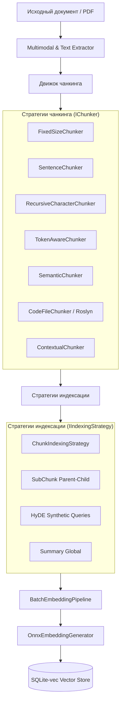
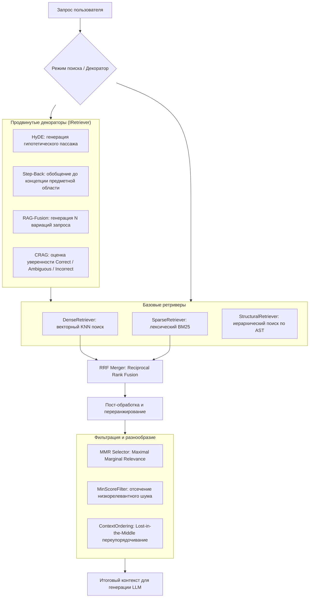
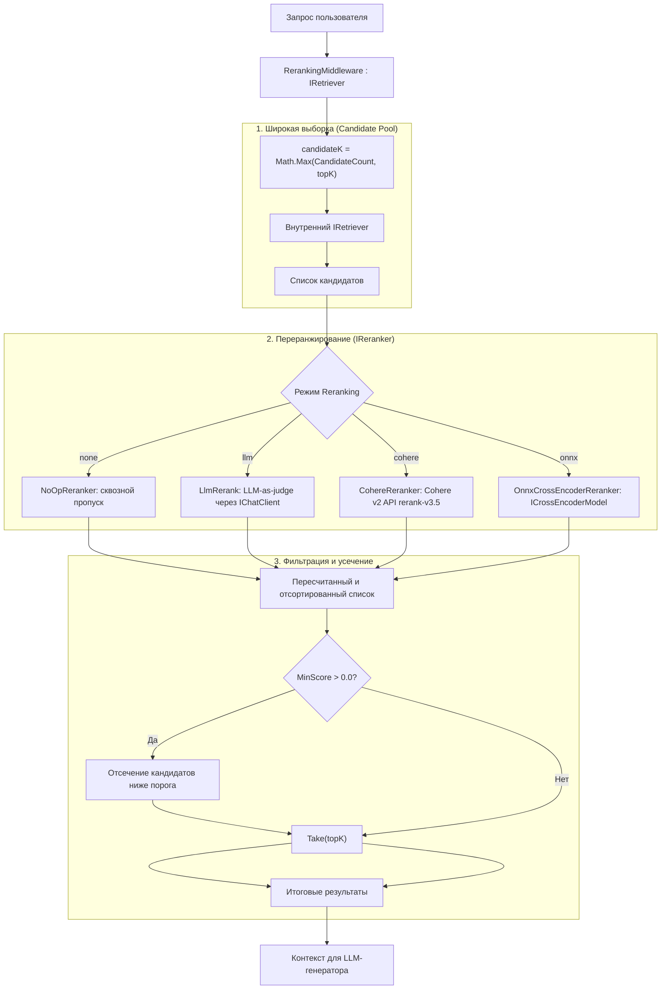
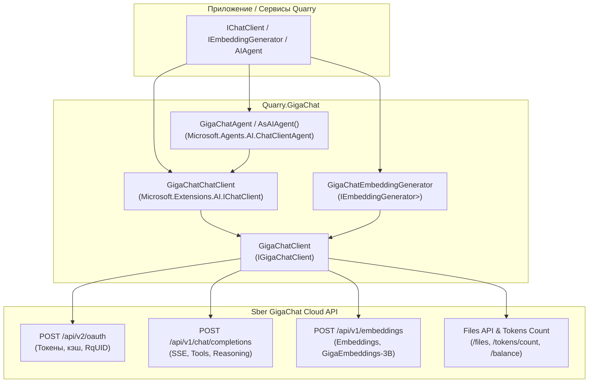
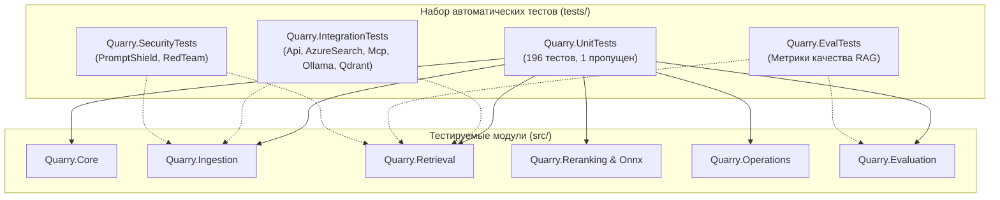

# Архитектура Quarry

## 1. Концепция и цели

Quarry проектируется как расширяемая, масштабируемая и автономная система:
* **Бэкенд**: ASP.NET Core REST API с поддержкой Server-Sent Events (SSE) для потоковой генерации ответов.
* **Клиент**: Кроссплатформенное приложение на Avalonia UI (MVVM, CommunityToolkit, Markdown.Avalonia).
* **Локальный AI**: Локальная векторизация текстов через ONNX Runtime без сетевых задержек и затрат на внешние API.
* **Поддержка языков**: Приоритет русскому языку с бесшовным пониманием англоязычных терминов и документов (кросс-языковой поиск).

---

## 2. Общая схема взаимодействия

---

## 3. Подсистема инжеста данных (Ingestion Pipeline)

Подсистема `Quarry.Ingestion` реализует сквозную обработку документов от сырых файлов до оптимизированных векторов:

### Ключевые возможности:
1. **Точный учет смещений символов (Offsets)**: каждый фрагмент хранит `StartCharOffset` и `EndCharOffset` для точной цитации и подсветки первоисточника.
2. **Анализ кода через Roslyn**: `CodeFileChunker` разбирает исходный код C# по AST-узлам (классы, методы, свойства) с метаданными символов.
3. **Мультимодальная обработка PDF**: `PdfPigImageExtractor` извлекает страницы, текст и растровые изображения, а `MultimodalChunker` генерирует кэпшены и формирует мультимодальные фрагменты.
4. **Непрерывная синхронизация (Change Feed)**: `IChangeFeed` и `DocumentReingestService` обеспечивают фоновое обновление векторного индекса при добавлении, изменении или удалении документов.

---

---

## 4. Модель эмбеддингов

* **Модель**: `intfloat/multilingual-e5-small` (int8 quantized).
* **Расположение**: `model/multilingual-e5-small/`.
* **Файлы**:
  * `model.onnx` (112.8 МБ) — квантованные веса для быстрого исполнения на CPU.
  * `sentencepiece.bpe.model` (4.8 МБ) — словарь токенизатора SentencePiece.
* **Размерность векторов**: 384 измерения.
* **Асимметричная схема промптов**:
  * Чанки документов: `passage: <текст>`
  * Поисковые запросы: `query: <текст>`
* **Особенности токенизации**:
  Для корректного сопоставления со словарем XLM-RoBERTa токены SentencePiece преобразуются через смещение:
  `<s>` (0) + `(raw_token + 1)` + `</s>` (2).

---

## 5. Подсистема поиска и ранжирования (Retrieval & Ranking)

Модуль `Quarry.Retrieval` реализует многоуровневый конвейер семантического, лексического и структурного поиска:

### Ключевые возможности:
1. **Гибридный поиск и Reciprocal Rank Fusion (RRF)**:
   * Одновременный параллельный запуск семантического (Dense) и лексического (Okapi BM25) поиска.
   * Слияние списков ранжирования по формуле:
     $$\text{RRF\_Score}(d) = \sum_{m \in M} \frac{1}{k + \text{rank}_m(d)}$$
     где $k = 60$ по умолчанию. Поддерживается слияние 2 списков и произвольного числа $N$ списков.
2. **Максимизация маржинальной релевантности (MMR Selector)**:
   * Устраняет избыточность и семантическое дублирование чанков в контексте LLM:
     $$\text{MMR}(d) = \operatorname{argmax}_{d \in C \setminus S} \left[ \lambda \cdot \text{Sim}(d, q) - (1 - \lambda) \max_{s \in S} \text{Sim}(d, s) \right]$$
   * Попарное сходство кандидатов рассчитывается аппаратно ускоренным SIMD `CosineKernel`.
3. **Безопасность и оптимизация контекста LLM**:
   * **`MinScoreFilter`**: фильтрация кандидатов с релевантностью ниже заданного порога для исключения нерелевантного шума и галлюцинаций.
   * **`ContextOrdering`**: оптимизация порядка чанков против эффекта "Lost in the Middle" (наиболее значимые чанки размещаются по краям контекстного окна LLM: $[r_1, r_3, r_5, \dots, r_4, r_2]$).
4. **Продвинутые ретривер-декораторы**:
   * **`HydeRetriever`**: синтезирует гипотетический документ через `IChatClient` и производит поиск в векторном пространстве ответов.
   * **`StepBackRetriever`**: выполняет параллельный поиск по исходному и более общему понятийному запросу с объединением результатов через RRF.
   * **`RagFusionRetriever`**: генерирует набор вариаций запроса, производит параллельный поиск и объединяет результаты в единый ранжированный список.
   * **`CragRetriever`**: проверяет оценку релевантности первого результата относительно порогов `upperThreshold` и `lowerThreshold` и осуществляет маршрутизацию (Correct, Ambiguous, Incorrect с переходом на фоллбэк).
5. **Безвекторная структурная навигация (Vectorless Structural Retrieval)**:
   * **`DocumentStructureParser`**: строит иерархическое дерево `StructuralIndex` из Markdown-документов, определяя идентификаторы статей/пунктов (`§ 1.1`, `Art 5`, `Глава 2`) и перекрестные ссылки (`[см. § 2.1]`).
   * **`StructuralRetriever`**: мгновенный $O(1)$ поиск по номеру раздела, навигация по иерархии (`Ancestors`, `Descendants`, `Siblings`) и замыкание по ссылкам через поиск в ширину (BFS).
   * **`LlmSectionRouter`**: интеллектуальная маршрутизация вопроса к разделам оглавления через LLM без эмбеддингов.

---

## 6. Подсистема переранжирования (Reranking Pipeline: Cross-Encoder & LLM)

Модули `Quarry.Reranking` и `Quarry.Reranking.Onnx` реализуют производственный паттерн **"retrieve-broadly, rerank-precisely"** (*широкая выборка кандидатов, точное переранжирование*):

### Ключевые возможности:
1. **Прозрачная декорация (`RerankingMiddleware`)**:
   Оборачивает существующий `IRetriever` с помощью библиотеки Scrutor, поэтому потребители конвейера продолжают работать с тем же интерфейсом `IRetriever`, не подозревая о наличии промежуточного шага переранжирования.
2. **Расширение пула кандидатов (`CandidateCount`)**:
   Внутренний ретривер запрашивает расширенное число кандидатов $K_{\text{cand}} = \max(\text{CandidateCount}, \text{topK})$ (по умолчанию 20), обеспечивая кросс-энкодер или LLM достаточным контекстом для отбора.
3. **Порог релевантности (`MinScore`)**:
   Позволяет отсекать низкокачественные результаты. Если ни один документ не преодолевает барьер, возвращается пустой список, давая генератору возможность честно отказаться от ответа и предотвращая галлюцинации.
4. **Адаптер локального ONNX кросс-энкодера (`Quarry.Reranking.Onnx`)**:
   * Реализует `ICrossEncoderModel` для модели **`BAAI/bge-reranker-v2-m3`** на базе `Microsoft.ML.OnnxRuntime`.
   * Вынесен в отдельный опциональный пакет для изоляции тяжелых нативных бинарных файлов ONNX Runtime от легковесного ядра.
   * Кодирует пары (запрос, документ) по схеме XLM-RoBERTa: `[<s>] query [</s></s>] doc [</s>]` со специальными токенами `bos=0`, `pad=1`, `eos=2`.
   * Масштабирует сырые логиты в вероятности $[0, 1]$ через функцию $\sigma(x) = \frac{1}{1 + e^{-x}}$.

---

## 7. Слой векторного хранения (SQLite-vec & InMemory)

В качестве основного движка векторной базы данных используется **SQLite** с нативным расширением **sqlite-vec** (`vec0`), а для тестирования и кэширования — потокобезопасное хранилище `InMemoryVectorStore`.

### Архитектурные преимущества SQLite-vec:
* **Полная автономность**: отсутствие необходимости развертывать внешние векторные СУБД (Qdrant, Milvus, pgvector) или Docker-контейнеры.
* **Портативность**: вся база знаний (тексты, метаданные и векторные индексы) хранится в одном файле на диске (`quarry.db`).
* **Производительность**: поиск ближайших соседей (KNN) выполняется скомпилированным C-кодом расширения с использованием векторных SIMD-инструкций процессора.
* **Кроссплатформенность (RID)**: поддержка работы на Linux, Windows и macOS благодаря размещению бинарников в стандартной структуре `runtimes/`:
  * `runtimes/linux-x64/native/vec0.so` (Linux x86_64 / Docker / Ubuntu / Debian)
  * `runtimes/linux-arm64/native/vec0.so` (Linux ARM64 / AWS Graviton / Raspberry Pi)
  * `runtimes/win-x64/native/vec0.dll` (Windows x64)
  * `runtimes/osx-arm64/native/vec0.dylib` (macOS Apple Silicon M1/M2/M3/M4)
  * `runtimes/osx-x64/native/vec0.dylib` (macOS Intel)

### Модель данных и организация таблиц:

```mermaid
erDiagram
    CHUNKS ||--|| VEC_CHUNKS : "1 : 1 (chunk_id)"
    CHUNKS {
        string chunk_id PK "Идентификатор фрагмента"
        string document_id FK "Идентификатор документа"
        int chunk_index "Порядковый номер"
        string text "Текст фрагмента"
        json metadata "Произвольные метаданные"
        string model "Модель эмбеддингов"
        datetime created_at "Время индексации"
    }
    VEC_CHUNKS {
        string chunk_id PK "Внешний ключ к chunks"
        float_array embedding "Вектор 384 измерений (vec0)"
    }
```

### Ключевые механизмы:
1. **Режим WAL (Write-Ahead Logging)**:
   При инициализации хранилища выполняются `PRAGMA journal_mode = WAL; PRAGMA synchronous = NORMAL;`, что устраняет блокировки читателей пишущими транзакциями.
2. **Нулевое копирование при передаче векторов**:
   Массивы `ReadOnlyMemory<float>` передаются в `Microsoft.Data.Sqlite` в виде сырых байт через `MemoryMarshal.AsBytes`, минуя дорогостоящую строковую или JSON-сериализацию.
3. **Pre-filtering по метаданным**:
   Поиск с фильтрацией объединяет виртуальную таблицу `vec0` и реляционную таблицу `chunks`, используя `json_extract(metadata, '$.key')` и подзапрос `chunk_id IN (...)`.
4. **Метрика сходства**:
   В виртуальной таблице задается `distance_metric=cosine`. Расстояние пересчитывается в доменный коэффициент релевантности:
   $$\text{Score} = 1.0 - \text{distance}$$

---

## 8. Интеграция с LLM и векторными сервисами: Сбер GigaChat (Quarry.GigaChat)

Модуль `Quarry.GigaChat` предоставляет нативную интеграцию с российскими генеративными моделями и сервисами эмбеддингов **Сбер GigaChat** через стандартные интерфейсы .NET AI:

### Ключевые возможности:
1. **Абстракции `Microsoft.Extensions.AI`**:
   * [`GigaChatChatClient`](file:///e:/Proba/Quarry/src/Quarry.GigaChat/ChatClient/GigaChatChatClient.cs) реализует `IChatClient`, обеспечивая взаимозаменяемость с локальными моделями, `LlmRerank` и другими LLM-провайдерами.
   * [`GigaChatEmbeddingGenerator`](file:///e:/Proba/Quarry/src/Quarry.GigaChat/Embeddings/GigaChatEmbeddingGenerator.cs) реализует `IEmbeddingGenerator<string, Embedding<float>>` для вычисления облачных эмбеддингов моделей `Embeddings`, `Embeddings-2`, `EmbeddingsGigaR` и `GigaEmbeddings-3B-2025-09`.
2. **Microsoft Agent Framework**:
   * Фабрика [`GigaChatAgent`](file:///e:/Proba/Quarry/src/Quarry.GigaChat/GigaChatAgent.cs) и расширения `.AsAIAgent()` создают `ChatClientAgent` с автоматической поддержкой инструментов (`AITool`, `AIFunctionFactory.Create`) и совместимостью с оркестраторами агентов.
3. **Полнофункциональный клиент REST API (`IGigaChatClient`)**:
   * Автоматическое обновление токенов OAuth 2.0 с упреждающим кэшированием (сброс за 3 минуты до истечения).
   * Потоковая передача ответов через Server-Sent Events (SSE) с разбором delta-сообщений и цепочек рассуждений (`reasoning_content`).
   * Встроенная работа с Files API (загрузка, скачивание, удаление файлов и прикрепление вложений к сообщениям).
   * Поддержка таймаутов, гибкой конфигурации HTTP-прокси и работы с сертификатами Минцифры (`IgnoreSslErrors = true`).

---

## 9. Инженерные стандарты сборки и управление пакетами

Для обеспечения надежности, чистоты кодовой базы и простоты сопровождения в корне решения настроены стандартные механизмы MSBuild:

* **`Directory.Build.props`**:
  * Целевая платформа: `.NET 9.0` (`net9.0`).
  * Язык: C# `latest` с обязательной проверкой `Nullable` и `ImplicitUsings`.
  * Статический анализ: уровень `latest-recommended` со встроенными анализаторами качества кода Roslyn.
  * Детерминированная сборка: `Deterministic=true`.
  * Метаданные: общие реквизиты автора, компании, продукта и версии.

* **`Directory.Packages.props` (Central Package Management — CPM)**:
  * Все версии NuGet-пакетов (`Microsoft.Data.Sqlite`, `Microsoft.ML.OnnxRuntime`, `Microsoft.Extensions.AI`, `Scrutor` и т.д.) зафиксированы в едином файле в корне репозитория.
  * В файлах `.csproj` используются элементы `<PackageReference Include="Название" />` без указания версии, что исключает конфликт версий зависимостей между библиотеками.

* **`Directory.Build.targets`**:
  * Пост-обработка процесса сборки проектов, диагностические хуки и автоматическая конфигурация вспомогательных пакетов.

---

## 10. Стратегия автоматизированного тестирования

Решение покрыто модульными и интеграционными тестами (xUnit), разделенными по зонам ответственности и категориям:

1. **`Quarry.UnitTests` (196 тестов, 1 пропущен)** — консолидированный проект модульного тестирования, организованный по предметным областям:
   * **`Documents/` & `Configuration/` (28 тестов Core)**:
     * Математическое ядро `CosineKernel`: единичное сходство идентичных векторов, нулевое сходство ортогональных, обработка произвольных размерностей (SIMD и хвостовой остаток), защита от нулевой нормы.
     * Фильтрация `MetadataFilter`: регистронезависимое сопоставление ключей/значений, множественные условия, безопасность при `null` метаданных.
     * Промпты `EmbeddingPrompt`: корректность префиксов для моделей E5, BGE, Nomic.
     * Доменные модели: неизменяемость записей `Document`, `DocumentChunk`, `EmbeddedChunk`, `RetrievalResult`, контракты интерфейсов `IRetriever` и `IVectorStore`, валидация смещений символов `StartCharOffset` и `EndCharOffset`.
   * **`Chunking/`, `Indexing/`, `Ingestion/`, `Multimodal/`, `Embeddings/` (41 тест Ingestion)**:
     * **Движок чанкинга**: проверка всех 7 стратегий (`FixedSizeChunker`, `SentenceChunker`, `RecursiveCharacterChunker`, `TokenAwareChunker` с `Cl100kBase`, `SemanticChunker`, `CodeFileChunker` на базе синтаксических деревьев Roslyn, `ContextualChunker`).
     * **Стратегии индексации**: стандартная, двухуровневая Parent-Child (`SubChunkIndexingStrategy`), генерация синтетических запросов HyDE (`HydeIndexingStrategy`), сводки документов (`SummaryIndexingStrategy`).
     * **Конвейер индексации**: сквозная векторизация и сохранение через `IndexingPipelineBuilder` и `IndexingPipeline`.
     * **Мультимодальная обработка**: извлечение страниц и текста из реального PDF через `PdfPigImageExtractor`, преобразование `MultimodalChunk` в `DocumentChunk`, кэпшенинг изображений через `IImageCaptioner`.
     * **Change Feed и фоновый реинжест**: публикация и вычитка из `ChannelChangeFeed`, фоновая служба `DocumentReingestService` для синхронизации создания/удаления документов.
     * **Внедрение зависимостей**: регистрация полного набора сервисов через `AddQuarryIngestion`.
     * **Эмбеддинги и инференс**: маппинг токенов `TokenMappers`, батчинг `BatchEmbeddingPipeline`, валидация размерностей `EmbeddingService`, инференс с квантованной ONNX-моделью.
   * **`Retrieval/`, `VectorStores/`, `Routing/` (42 теста Retrieval)**:
     * **Базовые ретриверы**: `DenseRetriever` (векторизация и поиск), `SparseRetriever` (BM25 ранжирование), `HybridRetriever` (параллельное исполнение и слияние), `RetrieverModeFactory` (разрешение по строковому имени).
     * **Ранжирование и фильтрация**: слияние `RrfMerger` с проверкой весов рангов, диверсификация `MmrSelector` со штрафом похожих векторов, отсечение `MinScoreFilter`, перестановка "Lost in the Middle" в `ContextOrdering`.
     * **Декораторы**: генерация гипотетических пассажей `HydeRetriever`, понятийное обобщение `StepBackRetriever`, множественная генерация запросов `RagFusionRetriever`, оценка уверенности `CragRetriever`.
     * **Структурный безвекторный поиск**: синтаксический анализ заголовков и перекрестных ссылок `DocumentStructureParser`, обход дерева и связей `StructuralRetriever`, маршрутизация вопросов по оглавлению `LlmSectionRouter`.
     * **Хранилища векторов**: `SqliteVectorStore` (идемпотентное создание, транзакционный Upsert, KNN-поиск с Pre-filter, удаление, персистентность на диске), `InMemoryVectorStore` (быстрый потокобезопасный поиск с пре-фильтрацией и косинусным сходством).
     * **Внедрение зависимостей**: регистрация `AddSqliteVectorStore`, `AddInMemoryVectorStore`, `AddQuarryRetrieval` с фабрикой стратегий по умолчанию.
   * **`Reranking/`, `Performance/` (28 тестов, 1 пропущен)**:
     * **Движки переранжирования**: `NoOpReranker` (усечение до topK с сохранением порядка), `LlmRerank` (парсинг численных оценок и фоллбэк на 0.5), `CohereReranker` (валидация HTTP-запроса, Bearer авторизации, сериализации payload и сопоставления индексов), `OnnxCrossEncoderReranker` (батчевое переранжирование и проброс оценок модели).
     * **Middleware и relevance floor**: `RerankingMiddleware` (выборка пула кандидатов, композиция стратегий, фильтрация по `MinScore` и возврат пустого списка при недостаточном качестве).
     * **Dependency Injection**: проверка регистрации `AddQuarryReranking` и `AddQuarryOnnxCrossEncoder` с переключением режимов (`none`, `llm`, `onnx`, `cohere`), валидацией обязательных зависимостей и прозрачной декорацией `IRetriever`.
     * **ONNX адаптер**: валидация входных аргументов и путей к файлам модели `BgeOnnxCrossEncoderModel`.
   * **`Operations/` (39 тестов Operations & FinOps)**:
     * **Backfill**: `BackfillScheduler` (параллельное перевстраивание векторов, отмена, возобновление с курсора).
     * **Procrustes SVD**: `DriftAdapter` (ортогональное выравнивание дрейфа эмбеддингов, сохранение косинусных расстояний).
     * **GDPR Art. 17**: `ForgetSubjectService` (транзакционное удаление персональных данных и векторов по субъекту).
     * **Бюджетирование и FinOps**: `BudgetEnforcingPipeline` и `TenantSpendLedger` (лимиты токенов/затрат, скользящее окно, мягкие и жесткие блокировки).
     * **Комплаенс и аудит**: `CitationAuditLog` (протоколирование цитат и атрибуций), `ComplianceDashboard` (EU AI Act отчетность).
   * **`Evaluation/` (18 тестов Evaluation)**:
     * **Метрики поиска**: `RetrievalEvaluator` (Recall@K, Precision@K, MRR, nDCG@K).
     * **Фактологичность**: `GenerationEvaluator` (LLM-as-judge декомпозиция утверждений, оценка SUPPORTED / PARTIAL / NOT_SUPPORTED).
     * **Статистическая значимость**: `StatisticalSignificance` (интервал Уилсона, парный бутстреп дельт с воспроизводимым сидом, тест Макнемара на несогласованных парах).
     * **MEAI Evaluation**: `CompositeEvaluator` (Retrieval, Groundedness, Relevance) и `BLEUEvaluator` через `Microsoft.Extensions.AI.Evaluation`.

2. **`Quarry.IntegrationTests`**:
   * Инфраструктурные тесты интеграции внешних сервисов: `Api/`, `AzureSearch/`, `Mcp/`, `Ollama/`, `Qdrant/`.
3. **`Quarry.EvalTests`**:
   * Оценка качества RAG (RAG Triad: Context Relevance, Groundedness, Answer Relevance).
4. **`Quarry.SecurityTests`**:
   * Тестирование безопасности: защита от prompt injection, экранирование входных данных, валидация прав доступа к чанкам.

**Итого**: 196 автоматизированных тестов, 100% прохождение, 0 предупреждений компилятора и анализаторов Roslyn.

