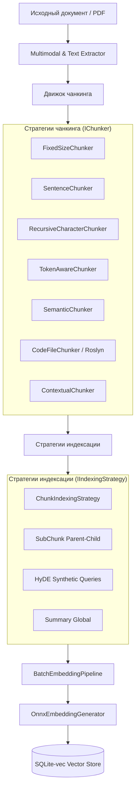

# Quarry.Ingestion

Слой подготовки, чанкинга, мультимодальной обработки, локальной векторизации (ONNX Runtime) и сквозной индексации документов в RAG-системе **Quarry**.

---

## Архитектура конвейера инжеста



---

## Зависимости

* `Quarry.Core`
* `Microsoft.ML.OnnxRuntime` — кроссплатформенная среда исполнения ONNX-моделей на CPU.
* `Microsoft.ML.Tokenizers` & `Microsoft.ML.Tokenizers.Data.Cl100kBase` — токенизаторы SentencePiece, BPE, TikToken.
* `Microsoft.CodeAnalysis.CSharp` — статический AST-анализ синтаксических деревьев C# (Roslyn).
* `PdfPig` — извлечение текста и встроенных изображений из PDF-документов.
* `Microsoft.Extensions.AI` — стандартные абстракции генераторов.
* `Microsoft.Extensions.Hosting.Abstractions` — контракты фоновых служб `BackgroundService`.
* `Microsoft.Extensions.Logging.Abstractions` — диагностическое логирование.

---

## Компоненты и пространства имен

### 1. Движок чанкинга (`Quarry.Ingestion.Chunking`)

* **`ChunkBuilder`** (`ChunkBuilder.cs`)  
  Унифицированный построитель чанков с генерацией идентификаторов `{documentId}#{index}`, наследованием метаданных документа и расчетом диапазонов смещений `StartCharOffset` и `EndCharOffset`.

* **`FixedSizeChunker`** (`FixedSizeChunker.cs`)  
  Разбиение текста на чанки фиксированной длины в символах с настраиваемым перекрытием (`chunkSize`, `overlap`).

* **`SentenceChunker`** (`SentenceChunker.cs`)  
  Разбиение текста по границам предложений (`.`, `!`, `?`, переводы строк) с агрегацией под целевой максимальный размер чанка и перекрытием предложений (`overlapSentences`).

* **`RecursiveCharacterChunker`** (`RecursiveCharacterChunker.cs`)  
  Иерархическое рекурсивное разбиение по набору разделителей (`\n\n`, `\n`, пробел, символ) с адаптивным слиянием фрагментов под заданные лимиты `chunkSize` и `chunkOverlap`.

* **`TokenAwareChunker`** (`TokenAwareChunker.cs`)  
  Чанкинг с жестким контролем бюджета токенов на основе любого токенизатора `Microsoft.ML.Tokenizers.Tokenizer` (BPE, Tiktoken, SentencePiece).

* **`SemanticChunker`** (`SemanticChunker.cs`)  
  Семантический чанкинг: разделяет предложения на смысловые группы на основе анализа падения косинусного сходства между соседними предложениями через `IEmbeddingService` и SIMD `CosineKernel`.

* **`CodeFileChunker`** (`CodeFileChunker.cs`)  
  Синтаксический AST-чанкинг исходного кода C# через Roslyn (`Microsoft.CodeAnalysis.CSharp`). Выделяет классы, методы, интерфейсы и свойства с сохранением контекста и метаданных символов.

* **`ContextualChunker`** (`ContextualChunker.cs`)  
  Декоратор Contextual Retrieval: обогащает каждый чанк описанием контекста документа перед векторизацией при сохранении точных исходных смещений символов.

---

### 2. Стратегии и конвейер индексации (`Quarry.Ingestion.Indexing` и `Strategies`)

* **`IIndexingStrategy`** (`IIndexingStrategy.cs`) & **`IndexedItem`** (`IndexedItem.cs`)  
  Контракт стратегии подготовки элементов к индексации: `IAsyncEnumerable<IndexedItem> ProcessAsync(Document document, CancellationToken ct)`.
* **`ChunkIndexingStrategy`** (`Strategies/ChunkIndexingStrategy.cs`)  
  Базовая стратегия прямой индексации чанков из выбранного `IChunker`.
* **`SubChunkIndexingStrategy`** (`Strategies/SubChunkIndexingStrategy.cs`)  
  Двухуровневая индексация (Parent-Child): документ делится на крупные родительские чанки, а те — на компактные дочерние суб-чанки для точного поиска с возвратом контекста родителя.
* **`HydeIndexingStrategy`** (`Strategies/HydeIndexingStrategy.cs`)  
  Стратегия HyDE: генерирует синтетические гипотетические запросы/вопросы для каждого фрагмента и индексирует их в векторном пространстве.
* **`SummaryIndexingStrategy`** (`Strategies/SummaryIndexingStrategy.cs`)  
  Генерирует и индексирует высокоуровневую сводку всего документа для глобального макро-поиска по базе знаний.
* **`IIndexingPipeline`** & **`IndexingPipeline`** (`IndexingPipeline.cs`)  
  Сквозной конвейер: получает документы, прогоняет через стратегию индексации, пакетно вычисляет эмбеддинги и сохраняет их в `IVectorStore`.
* **`IndexingPipelineBuilder`** (`IndexingPipelineBuilder.cs`)  
  Fluent API для гибкой конфигурации и сборки пайплайна (`WithChunker`, `WithStrategy`, `WithEmbeddingService`, `WithVectorStore`, `WithBatchSize`).

---

### 3. Мультимодальная обработка PDF (`Quarry.Ingestion.Multimodal`)

* **`MultimodalChunk`** (`MultimodalChunk.cs`)  
  Фрагмент документа, содержащий текст, номер страницы и бинарные медиаданные (байты изображения, MIME-тип, кэпшен). Метод `ToDocumentChunk()` преобразует его в формат для векторного индекса.
* **`IPdfImageExtractor`** & **`PdfPigImageExtractor`** (`PdfPigImageExtractor.cs`)  
  Извлечение страниц, текста и встроенных растровых изображений из файлов PDF на базе библиотеки `PdfPig`.
* **`IImageCaptioner`** & **`DefaultImageCaptioner`** (`IImageCaptioner.cs`)  
  Генерация текстовых описаний и кэпшенов для изображений с поддержкой подключения Vision LLM или шаблонных метаданных.
* **`MultimodalChunker`** (`MultimodalChunker.cs`)  
  Мультимодальный обработчик PDF-документов: извлекает страницы, генерирует кэпшены для изображений и выдает поток мультимодальных чанков.

---

### 4. Непрерывная синхронизация и Change Feed (`Quarry.Ingestion.Events`)

* **`DocumentChanged`** & **`DocumentChangeType`** (`DocumentChanged.cs`)  
  Модель событий жизненного цикла документов (`Created`, `Updated`, `Deleted`).
* **`IChangeFeed`** & **`ChannelChangeFeed`** (`ChannelChangeFeed.cs`)  
  Потокобезопасный Change Feed на базе каналов `System.Threading.Channels`, обеспечивающий публикацию и вычитку событий в реальном времени.
* **`DocumentReingestService`** (`DocumentReingestService.cs`)  
  Фоновая служба `BackgroundService`, подписывающаяся на Change Feed и автоматически выполняющая переиндексацию или удаление векторов в хранилище.

---

### 5. Локальный инференс эмбеддингов (`Quarry.Ingestion.Embeddings`)

* **`OnnxEmbeddingGenerator`** (`Embeddings/Onnx/OnnxEmbeddingGenerator.cs`)  
  Универсальная реализация `IEmbeddingGenerator<string, Embedding<float>>` на базе ONNX Runtime:
  * Mean Pooling скрытых состояний токенов с учетом `attention_mask`.
  * L2-нормализация выходного вектора (единичная евклидова длина).
  * Корректное освобождение нативных ресурсов `InferenceSession`.
* **`TokenMappers`** (`Embeddings/Onnx/TokenMappers.cs`)  
  Маппинг токенов: `Direct` (BERT) и `XlmRoberta` (добавление BOS `<s> = 0`, смещение ID подслов на `+1`, добавление EOS `</s> = 2`).
* **`EmbeddingService`** (`Embeddings/EmbeddingService.cs`)  
  Реализация `IEmbeddingService`. Инкапсулирует вызовы `_prompt.Apply(...)` для разделения префиксов `passage:` и `query:`, валидирует размерности.
* **`BatchEmbeddingPipeline`** (`Embeddings/BatchEmbeddingPipeline.cs`)  
  Пакетный конвейер векторизации: разбивает входящий поток чанков на батчи фиксированного размера (по умолчанию 32) для максимальной утилизации CPU.

---

### 6. Внедрение зависимостей (`Quarry.Ingestion.DependencyInjection`)

* **`ServiceCollectionExtensions`** (`ServiceCollectionExtensions.cs`)  
  Регистрирует полный набор компонентов инжеста в DI-контейнере:
  ```csharp
  services.AddQuarryIngestion(options =>
  {
      options.DefaultChunker = "recursive";
      options.BatchSize = 32;
      options.EnableChangeFeedService = true;
  });
  ```

---

## Тестирование

Модуль полностью покрыт автоматическими тестами в проекте `tests/Quarry.Ingestion.Tests`:
* **41 тест**, 100% прохождение, 0 предупреждений анализатора.
* Проверяются: все 7 стратегий чанкинга, Roslyn AST разбор, кэпшенинг и извлечение из реального PDF, Change Feed и фоновый реинжест, ONNX инференс с моделью `multilingual-e5-small`.
