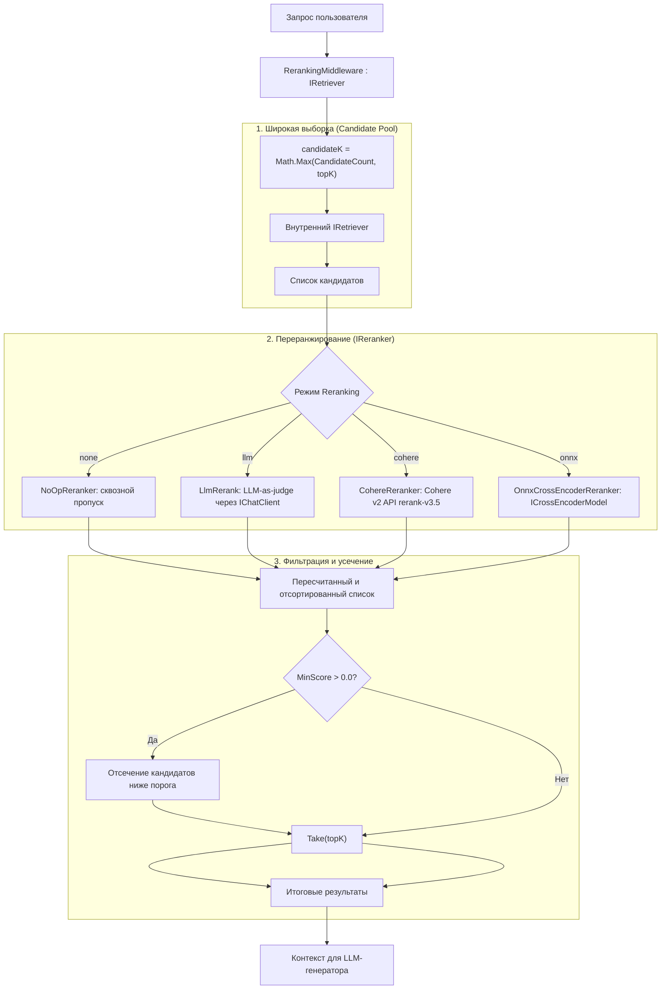

# Quarry.Reranking

Слой переранжирования (Reranking) для RAG-архитектуры **Quarry**, реализующий производственный паттерн **"retrieve-broadly, rerank-precisely"** (*широкая выборка кандидатов, точное ранжирование*).

---

## Архитектура конвейера переранжирования



---

## Ключевые возможности

1. **Прозрачная декорация (`RerankingMiddleware`)**:
   Оборачивает любой зарегистрированный `IRetriever` через библиотеку [Scrutor](https://github.com/khellang/Scrutor), поэтому остальной конвейер (генератор, контроллеры, пайплайны) не знает о наличии слоя переранжирования.
2. **Паттерн "Retrieve-Broadly, Rerank-Precisely"**:
   Запрашивает из векторного/гибридного хранилища расширенный пул кандидатов (`CandidateCount`, по умолчанию 20), оценивает их тяжелым кросс-энкодером или языковой моделью и отбирает `topK` лучших.
3. **Порог отсечения релевантности (`MinScore`)**:
   Возможность задать минимальный порог оценки (релевантный пол). Если документы не преодолевают порог, они отбрасываются, вплоть до возврата пустого списка, позволяя модели честно ответить *"Недостаточно данных для ответа"*, избегая галлюцинаций.
4. **Многообразие реализаций**:
   * `NoOpReranker` — контрольный запуск для A/B тестирования и безопасный резервный вариант.
   * `LlmRerank` — оценка релевантности языковой моделью (`IChatClient`, например локальная Ollama или Azure OpenAI).
   * `CohereReranker` — облачный HTTP-клиент к эндпоинту Cohere v2 Rerank (`rerank-v3.5`).
   * `OnnxCrossEncoderReranker` — легковесная абстракция над локальной нейросетевой моделью кросс-энкодера (`ICrossEncoderModel`).

---

## Зависимости

* `Quarry.Core` — базовые доменные типы (`DocumentChunk`, `RetrievalResult`, `IRetriever`) и конфигурация (`QuarryOptions`, `RerankingOptions`).
* `Quarry.Retrieval` — интерфейсы и реализации поиска.
* `Microsoft.Extensions.AI.Abstractions` — контракты работы с чат-клиентами (`IChatClient`).
* `Microsoft.Extensions.Options` — типизированная конфигурация options pattern.
* `Microsoft.Extensions.Http` — работа с HTTP-фабриками для вызова внешних API.
* `Scrutor` — декорация сервисов в `IServiceCollection`.

---

## Компоненты библиотеки

### 1. Контракты (`Quarry.Reranking`)

* **`IReranker`**:
  ```csharp
  public interface IReranker
  {
      string Implementation { get; }

      Task<IReadOnlyList<RetrievalResult>> RerankAsync(
          string query,
          IReadOnlyList<RetrievalResult> candidates,
          int topK,
          CancellationToken cancellationToken = default);
  }
  ```
* **`ICrossEncoderModel`**:
  Синхронный пакетный порт для self-hosted кросс-энкодеров (без привязки к конкретному движку ONNX):
  ```csharp
  public interface ICrossEncoderModel
  {
      string ModelId { get; }
      IReadOnlyList<float> Score(string query, IReadOnlyList<string> documents);
  }
  ```

### 2. Реализации переранжировщиков

| Класс | Идентификатор | Описание |
|---|---|---|
| `NoOpReranker` | `no-op` | Сохраняет исходный порядок, лишь усекает список до `topK`. |
| `LlmRerank` | `llm-as-judge` | Оценивает каждый пассаж промптом к `IChatClient` по шкале 0.0–1.0. |
| `CohereReranker` | `cohere-{model}` | Вызывает Cohere API v2 Rerank (`rerank-v3.5`) с Bearer-токеном. |
| `OnnxCrossEncoderReranker` | `onnx-cross-encoder({model})` | Делегирует батчевый скоринг объекту `ICrossEncoderModel`. |

### 3. Декоратор `RerankingMiddleware`

Реализует `IRetriever`:
```csharp
var middleware = new RerankingMiddleware(
    inner: baseRetriever,
    reranker: reranker,
    candidateCount: 20,
    minScore: 0.25);

var results = await middleware.RetrieveAsync("вопрос", topK: 5);
```

---

## Регистрация в Dependency Injection

```csharp
using Microsoft.Extensions.DependencyInjection;
using Quarry.Reranking.DependencyInjection;

// 1. Сначала регистрируем базовый IRetriever (например, из Quarry.Retrieval)
services.AddSingleton<IRetriever, HybridRetriever>();

// 2. Добавляем Quarry.Reranking и настраиваем параметры
services.AddQuarryReranking(options =>
{
    options.Mode = "llm"; // "none" | "llm" | "cohere" | "onnx"
    options.CandidateCount = 20;
    options.MinScore = 0.3;
});
```

Также поддерживается конфигурация через `appsettings.json`:

```json
{
  "Quarry": {
    "Reranking": {
      "Mode": "onnx",
      "CandidateCount": 25,
      "MinScore": 0.2
    }
  }
}
```
