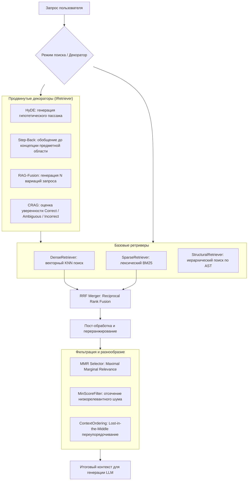

# Quarry.Retrieval

Слой семантического, лексического, гибридного и структурного поиска, алгоритмов ранжирования (RRF, MMR, Context Ordering) и хранения векторов (SQLite-vec, InMemory) в RAG-системе **Quarry**.

---

## Архитектура конвейера поиска



---

## Зависимости

* `Quarry.Core`
* `Microsoft.Data.Sqlite` — доступ к СУБД SQLite через ADO.NET с поддержкой нативных C-расширений.
* `Microsoft.Extensions.AI.Abstractions` — базовые контракты AI (`IChatClient`, `ChatMessage`, `ChatResponse`).
* `Microsoft.Extensions.DependencyInjection.Abstractions` — внедрение зависимостей.
* `Microsoft.Extensions.Logging.Abstractions` — диагностическое логирование.
* Нативная библиотека `vec0` (`vec0.dll` / `vec0.so` / `vec0.dylib`) — векторное расширение SQLite.

---

## Компоненты и пространства имен

### 1. Базовые ретриверы и ранжирование (`Quarry.Retrieval`)

* **`DenseRetriever`** (`DenseRetriever.cs`)  
  Реализация `IRetriever` для плотного векторного поиска:
  * Векторизует поисковый запрос через `IEmbeddingService.EmbedQueryAsync` (с префиксом `query:`).
  * Выполняет KNN-поиск через `IVectorStore.SearchAsync` с опциональным пре-фильтром метаданных.

* **`SparseRetriever`** (`SparseRetriever.cs`)  
  Реализация `IRetriever` для лексического полнотекстового поиска на базе алгоритма **Okapi BM25**:
  * Параметры алгоритма: $k_1 = 1.2$, $b = 0.75$.
  * Инвертированный индекс в памяти: метод `Index(IEnumerable<DocumentChunk> chunks)` индексирует документы, рассчитывая IDF для каждого терма.
  * Потокобезопасная переиндексация.

* **`HybridRetriever`** (`HybridRetriever.cs`)  
  Реализация `IRetriever` для гибридного поиска (Dense + BM25):
  * Параллельно выполняет запрос к плотному и лексическому ретриверам через `Task.WhenAll`.
  * Объединяет результаты с помощью алгоритма `RrfMerger` (Reciprocal Rank Fusion).

* **`RetrieverModeFactory`** (`RetrieverModeFactory.cs`)  
  Фабрика динамического выбора стратегии поиска по строковому идентификатору (`"dense"`, `"sparse"`, `"hybrid"`).

* **`RrfMerger`** (`RrfMerger.cs`)  
  Слияние ранжированных списков по алгоритму **Reciprocal Rank Fusion**:
  $$\text{Score}(d) = \sum_{m} \frac{1}{k + \text{rank}_m(d)}$$
  * Стандартная константа сглаживания $k = 60$.
  * Методы: `Merge(listA, listB, topK)` для двух списков и `Merge(IEnumerable<IReadOnlyList<RetrievalResult>> lists, topK)` для $N$ списков.

* **`MmrSelector`** & **`MmrCandidate`** (`MmrSelector.cs`)  
  Диверсификатор результатов по алгоритму **Maximal Marginal Relevance** (MMR):
  $$\text{MMR}(d) = \lambda \cdot \text{Sim}(d, q) - (1 - \lambda) \max_{s \in S} \text{Sim}(d, s)$$
  * Использует SIMD-ускоренный `CosineKernel` для расчета попарных сходств между кандидатами.
  * Исключает попадание в контекст модели избыточных семантических дубликатов.

* **`MinScoreFilter`** (`MinScoreFilter.cs`)  
  Декоратор над `IRetriever`, отсекающий результаты со значением `Score < minScore`. Защищает от передачи нерелевантного контекста и снижает галлюцинации LLM.

* **`ContextOrdering`** (`ContextOrdering.cs`)  
  Алгоритм устранения эффекта **"Lost in the Middle"**:
  * Метод `Interleave(ranked)` переупорядочивает список рангов $[1, 2, 3, 4, 5] \to [1, 3, 5, 4, 2]$, размещая наиболее значимые чанки по краям контекстного окна трансформера.

---

### 2. Продвинутые ретривер-декораторы (`Quarry.Retrieval.Decorators`)

* **`HydeRetriever`** (`Decorators/HydeRetriever.cs`)  
  Декоратор **Hypothetical Document Embeddings** (HyDE): синтезирует гипотетический ответ через `IChatClient` и ищет чанки по его эмбеддингу с безопасным fallback на оригинальный запрос.

* **`StepBackRetriever`** (`Decorators/StepBackRetriever.cs`)  
  Декоратор **Step-Back Prompting**: формулирует более широкий понятийный запрос, параллельно опрашивает ретривер и объединяет результаты через RRF.

* **`RagFusionRetriever`** (`Decorators/RagFusionRetriever.cs`)  
  Декоратор **RAG-Fusion**: генерирует $N$ вариаций поискового запроса, параллельно выполняет поиск и производит $N$-стороннее RRF-слияние.

* **`CragRetriever`** (`Decorators/CragRetriever.cs`)  
  Декоратор **Corrective RAG** (CRAG): оценивает оценку уверенности топ-результата относительно верхнего (`upperThreshold`) и нижнего (`lowerThreshold`) порогов:
  * **Correct**: возврат результатов напрямую.
  * **Incorrect**: переключение на резервный источник (`topicFallback`).
  * **Ambiguous**: объединение результатов основного и резервного источников.

---

### 3. Безвекторная структурная навигация (`Quarry.Retrieval.Vectorless`)

* **`StructuralNode`** & **`StructuralIndex`** (`Vectorless/StructuralNode.cs`, `Vectorless/StructuralIndex.cs`)  
  Иерархическое представление дерева разделов Markdown с быстрым $O(1)$ доступом по стабильным идентификаторам (`§1.1`, `глава2`).
* **`DocumentStructureParser`** (`Vectorless/DocumentStructureParser.cs`)  
  Синтаксический анализатор Markdown: парсит заголовки H1–H6, вычленяет номера статей и перекрестные ссылки вида `[см. § 2.1]`.
* **`StructuralRetriever`** (`Vectorless/StructuralRetriever.cs`)  
  Безвекторный ретривер (реализует `IRetriever`): поиск точных номеров разделов, обход иерархии (`Descendants`, `Ancestors`, `Siblings`) и BFS-замыкание по перекрестным ссылкам.
* **`LlmSectionRouter`** (`Vectorless/LlmSectionRouter.cs`)  
  Маршрутизатор вопросов пользователя по оглавлению документа через `IChatClient` без вычисления эмбеддингов.

---

### 4. Векторные хранилища (`Quarry.Retrieval.VectorStores`)

* **`SqliteVectorStore`** (`VectorStores/SqliteVectorStore.cs`)  
  Полнофункциональное хранилище векторов на базе SQLite и sqlite-vec:
  * Виртуальная таблица `vec0` (`distance_metric=cosine`).
  * Режим упреждающей записи WAL (`PRAGMA journal_mode = WAL;`).
  * Нулевое копирование векторов через `MemoryMarshal.AsBytes`.
  * Pre-filtering по метаданным через `json_extract`.
  * Кроссплатформенная загрузка нативных библиотек (`vec0.dll`, `vec0.so`, `vec0.dylib`).

* **`InMemoryVectorStore`** (`VectorStores/InMemoryVectorStore.cs`)  
  Потокобезопасное хранилище векторов в оперативной памяти:
  * Идеально для unit-тестов, кэшей и стендов.
  * Точный поиск косинусного сходства через SIMD `CosineKernel`.
  * Поддержка `MetadataFilter` и удаления по идентификаторам.

---

### 5. Внедрение зависимостей (`Quarry.Retrieval.DependencyInjection`)

* **`ServiceCollectionExtensions`** (`DependencyInjection/ServiceCollectionExtensions.cs`)  
  Методы расширения для регистрации в `IServiceCollection`:
  ```csharp
  services.AddSqliteVectorStore(options =>
  {
      options.ConnectionString = "Data Source=quarry.db";
      options.Dimensions = 384;
  });

  services.AddQuarryRetrieval(options =>
  {
      options.DefaultMode = "hybrid";
      options.MinScore = 0.5;
  });
  ```

---

## Тестирование

Модуль полностью покрыт автоматическими тестами в проекте `tests/Quarry.Retrieval.Tests`:
* **42 теста**, 100% прохождение, 0 предупреждений анализатора.
* Проверяются: `DenseRetriever`, `SparseRetriever` (BM25), `HybridRetriever`, `RrfMerger`, `MmrSelector`, `MinScoreFilter`, `ContextOrdering`, декораторы HyDE, Step-Back, RAG-Fusion, CRAG, структурный поиск и AST-парсер, хранилища `SqliteVectorStore` и `InMemoryVectorStore`.
